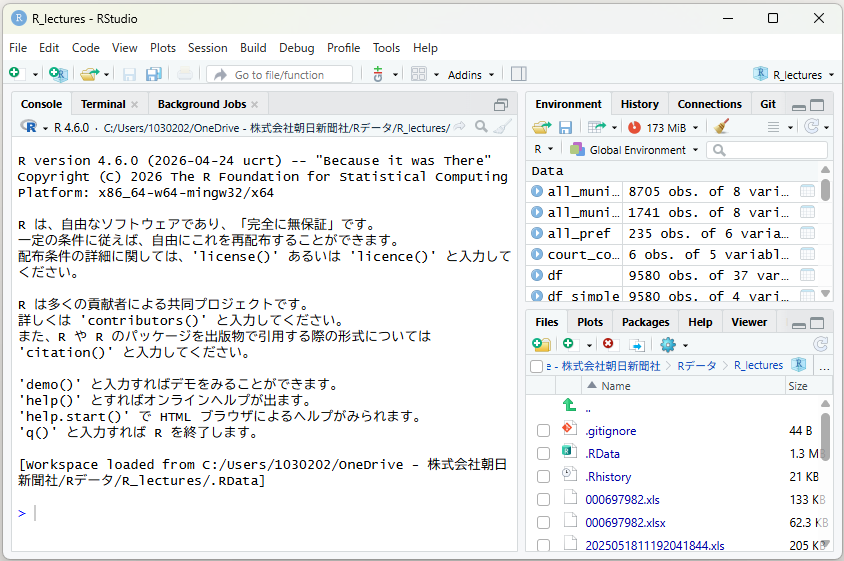

# 記者のためのR講座（ウェブサイト）

`content/` に置いたMarkdownから、`docs/` に静的なHTMLを書き出す仕組みです。
ビルドに必要なのはPythonだけ（外部ライブラリなし）。

## 使い方

書き足す・直す：

1. `content/` のなかの `.md` を編集する
2. 組み立てる

```bash
python build.py
```

3. `docs/index.html` をブラウザで開いて確認する

書き出し先の `docs/` は毎回まるごと作り直されます（GitHub Pages がこのフォルダを配信します）。**`docs/` の中を直接編集しても次のビルドで消えます。** 直すのは必ず `content/` のほうを。

GitHub Pages で公開しています。`git push` すれば数十秒で反映されます。

## ファイルの構成

```
r-course/
├── build.py          組み立てスクリプト。目次の順番もここで定義
├── make-figures.R    実行結果とグラフを作り直すRスクリプト
├── content/          本文（Markdown）
├── outputs/          Rの実行結果（テキスト。make-figures.Rが作る）
├── images/           グラフと画面写真
├── files/            読者にダウンロードしてもらうデータ
├── assets/
│   ├── style.css     見た目。明るい画面と暗い画面の両方に対応
│   ├── site.js       目次の開閉と、コードのコピー止め
│   └── notes.js      読みながらメモする仕組み（手元で開いたときだけ動く）
└── docs/             書き出されたHTML（自動生成。編集しない。GitHub Pagesがここを配信する）
```

`outputs/` と `images/` のグラフは **make-figures.R が作っています**。データを新しくしたときは

```bash
Rscript make-figures.R
python build.py
```

の順に実行すれば、本文中の実行結果とグラフが全部入れ替わります。手で貼り直す必要はありません。
スクリプトの冒頭にある `DATA` の行を、自分のデータの置き場所に書き換えてから使ってください。

## 章を増やす・順番を変える

`build.py` の冒頭にある `PARTS` を編集します。

```python
PARTS = [
    (None, ["index"]),
    ("はじめに", ["01-hajimeni", "02-install", "03-project"]),
    ...
]
```

タプルの1つ目が目次の見出し（`None` なら見出しなし）、2つ目がそこに並べるファイル名（`.md` は書かない）。ここに書いた順番が、そのまま目次と「前へ／次へ」の順番になります。

新しい章を足すときは、`content/22-chizu.md` を作って、`PARTS` の好きな場所に `"22-chizu"` を足すだけです。

## 工事中にする・公開する

`build.py` の `WIP_PARTS` に書いた部の章は、本文を出さずに「工事中」のページだけを書き出します（目次にも「工事中」と出ます）。公開してよくなったら、そこから部の名前を消してビルドし直してください。

工事中の章を手元で読みたいときは、`python build.py --preview` を実行してください。工事中の部も本文を出したページが `preview/` に書き出されるので、`preview/index.html` をブラウザで開きます。`preview/` は履歴に入れないので、公開サイトは工事中のままです。

## 公開サイトと手元での違い

- **コードはコピーできません。** 自分で打ち込んだほうが身につくので、コードの枠のなかは選択・コピー・右クリックができないようにしてあります（ページのソースを見れば読めるので、あくまで「手間をかける」ための仕掛けです）。
- **メモ機能と「要検討」の印は、手元で開いたときだけ出ます。** `docs/index.html` をファイルとして直接開いたときと、localhost で開いたときが「手元」です。GitHub Pages で公開しているサイトでは、メモのボタンは出ず、「要検討」の印や `{{! }}` のメモも表示されません（印のついた文は、ふつうの文として読めます）。

## 各ページの先頭に書くもの

```markdown
---
title: 折れ線グラフ
nav: 12 折れ線グラフ
kicker: 第2部　データを見る
lead: この章で何をやるかの一文。ページの冒頭に大きめの字で出ます。
---
```

| 項目 | 役割 |
|---|---|
| `title` | ページの見出し（h1）とブラウザのタブ |
| `nav` | 左の目次に出す短い名前。省略すると `title` を使う |
| `kicker` | 見出しの上に小さく出る部（省略可） |
| `lead` | 冒頭のリード（省略可） |

## 使えるMarkdownの書き方

ふつうのMarkdownの一部だけを実装しています。以下が使えるもの。

- `##` `###` `####` の見出し（`##` は「このページの中身」に自動で並びます）
- 段落、`- ` の箇条書き、`1. ` の番号つき箇条書き
- `**太字**`（黄色いマーカーが引かれます）
- `` `コード` ``。バッククオート自体を含めたいときは ``` ``  `列名`  `` ``` のように二重にする
- `[表示する文字](11-join.html)` のリンク
- `> ` の引用
- `---` の区切り線
- 表

```markdown
| 関数 | すること |
|---|---|
| `select()` | 列を選ぶ |
```

セルの中で縦棒そのものを使いたいときは `\|` と書く。

- コードブロック（言語名を書くと左上にラベルが出ます）

````markdown
```r
df %>% select(region)
```
````

`r` は「R」、`text` は「画面に出るもの」、`console` は「コンソール」と表示されます。
コードブロックの中にコードブロックを入れたいときは、外側をバッククオート4つで囲みます。

- 実行結果の読み込み。`outputs/` のテキストファイルを本文に差し込みます。ファイル名のあとに文字を並べると、その文字に色がつきます。

````markdown
```out outputs/05-simple.txt <chr> <dbl>
```
````

  `out` は「実行結果」、`file` は「ファイルの中身」というラベルで表示されます。ファイルがまだ無いときは、その場に注意書きが出て、ビルド時に一覧で知らせます。
  色をつけたい場所を本文側で直接囲みたいときは、コードブロックのなかで `«ここ»` のようにギュメで囲みます。

- 画像

```markdown

```

  画像がまだ無いときは、点線の枠で「ここに画像を入れる」と表示され、ビルド時に足りないファイルの一覧が出ます。だから**先に本文を書いて、画像はあとから足す**という進め方ができます。

- ダウンロード用のリンク。`files/` に置いたファイルへのリンクは、自動でボタンの見た目になり、**ファイルの大きさも自動で入ります**。

```markdown
[人口データ2020.csv](files/人口データ2020.csv)
```

  `files/` の中身は `site/files/` にコピーされ、あわせて `r-course-data.zip`（まとめてダウンロード用）が毎回作り直されます。ファイルが無いリンクは「ファイル未配置」と表示され、ビルド時に一覧で知らせます。

- 囲み記事

```markdown
:::warn 見出しの文字
中身。ここにはコードブロックや箇条書きも書けます。
:::
```

種類は5つ。見出しの文字を省略すると、既定の名前（かっこ内）が入ります。

| 書き方 | 見た目・使いどころ |
|---|---|
| `:::note`（メモ） | 青。補足や理屈の説明 |
| `:::tips`（コツ） | 緑。実務の小技 |
| `:::warn`（つまずきポイント） | 赤。エラーや事故のもと |
| `:::homework`（宿題） | 黄色。章末の宿題 |
| `:::data`（使うデータ） | 紫。その章で使うファイルの案内 |
| `:::column`（寄り道） | 灰色。本筋から外れた話 |

- HTMLを直接書くこともできます（行の頭が `<` で始まっていれば、空行までそのまま通します）。トップページのカードがその例です。

## 「要検討」の印

Claudeが書いた意見・規範の部分には印をつけてあります。サイト上では赤い枠と「要検討」のラベルで表示され、ビルド時に一覧が出ます。判断して、消すか書き直すか採用するかを決めてください。

| 対象 | 書き方 | 外し方 |
|---|---|---|
| 文 | `{{? この文 }}` | `{{?` と `}}` を消す |
| 囲み記事 | `:::warn 見出し @要検討` | 末尾の ` @要検討` を消す |
| 章ぜんたい | frontmatterに `review: 注記` | その行を消す |

一覧は `_私の追記一覧.txt` にも書き出してあります（場所と行番号つき）。

## 書きかけの目印

本文に `TODO` と書いておくと、ビルドしたときに一覧で表示されます。足りない画像・出力ファイルも同じように出ます。

```
--- まだ用意されていない画像・出力ファイルが 4 件あります ---
  images/02-new-rmd.png
  images/02-rstudio.png
  images/03-new-project.png
  images/04-view.png

--- 書きかけ・要確認（TODO）が 2 件あります ---
  a4-data          TODO：勉強会用のファイルの置き場所をここに書く
```

## 画像にするか、テキストにするか

迷ったときの基準です。

| 見せたいもの | やり方 |
|---|---|
| tibbleの表示、エラーや警告、コンソールの出力 | **テキスト**（`outputs/` に保存して `out` で差し込む） |
| csvやExcelの中身（上に何行あるか、など） | **テキスト**（`file` で差し込む） |
| ggplotで描いたグラフ | **画像**（make-figures.Rが自動で作る） |
| RStudioの画面、メニューの操作、Excelの見た目 | **画像**（手で撮ってimages/に置く） |
| 概念の説明（縦長と横長、joinの仕組み） | **手描きのSVG**（09章と11章に例あり） |
| 読者に配るデータ | `files/` に置いて `[名前](files/…)` でリンク |

Rの出力を画像にしないのは、テキストなら検索できる、暗い画面でも読める、スマホでも崩れない、そしてデータを更新したときに勝手に入れ替わる、という理由からです。

## 元になった資料

- `●記者のためのR入門.pdf`（書きかけのテキスト）
- `R_lectures01.Rmd`（2025年4月9日〜5月28日の勉強会のコード）
- `R_lectures02.Rmd`（2025年6月4日〜6月18日の勉強会のコード）
